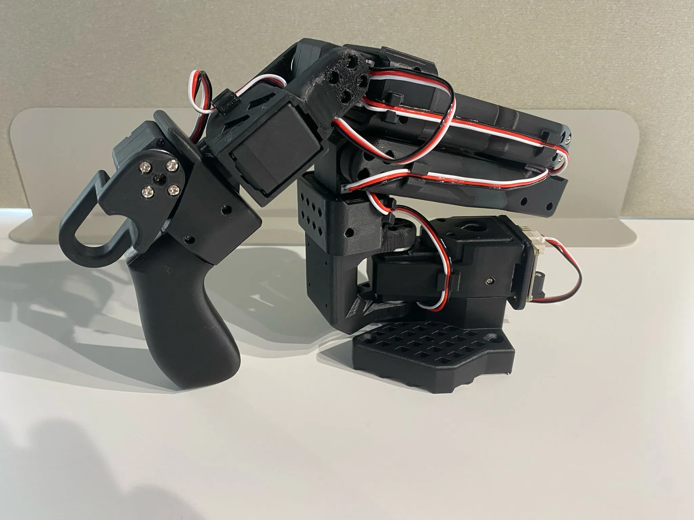
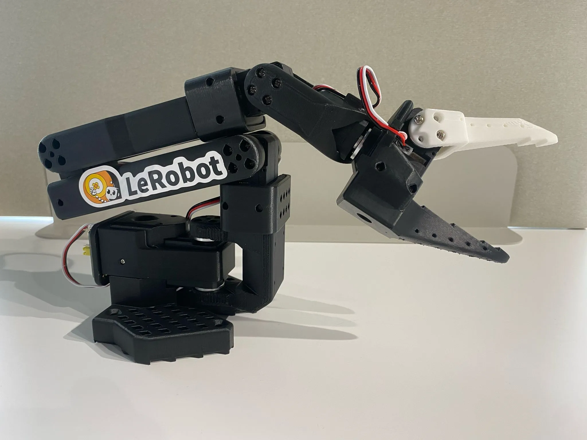

# SO-101 Field Guide

From a box of servos to a follower arm that mirrors your hand, on an NVIDIA DGX Spark. No AI is involved until the last chapter.

<figure markdown>

<figcaption><strong>Leader</strong> · the arm you move by hand. Light gearing, handle and trigger.</figcaption>
</figure>
<figure markdown>

<figcaption><strong>Follower</strong> · the arm that copies it. Six identical servos and a gripper.</figcaption>
</figure>

## What you will have at the end

- Two assembled SO-101 arms, each with six servos numbered 1 to 6.
- A DGX Spark with LeRobot installed, verified and talking to both arms.
- Both arms calibrated, with the calibration backed up.
- A one-line command that starts the follow-me demo: you move the leader, the follower copies it.

## The route

Do the chapters in order. The servo IDs in chapter 4 are much easier to set **before** the servos are screwed into the arms, which is why assembly comes after it.

<ol class="route">
<li>
<a href="01-parts.html">Parts and tools</a>Sort the twelve servos, check boards and power supplies.
</li>
<li>
<a href="02-spark-setup.html">Prepare the Spark</a>Install LeRobot, verify the GPU and the command-line tools.
</li>
<li>
<a href="03-ports.html">Controller boards and ports</a>Give each arm a fixed device name.
</li>
<li>
<a href="04-servo-ids.html">Servo IDs</a>Write IDs 1 to 6 into each servo, one at a time.
</li>
<li>
<a href="05-assembly.html">Assemble the arms</a>Build both arms joint by joint and daisy-chain the servos.
</li>
<li>
<a href="06-calibration.html">Calibrate</a>Teach both arms the same zero point and joint ranges.
</li>
<li>
<a href="07-follow-me.html">Follow-me demo</a>Run teleoperation and wrap it in a demo script.
</li>
</ol>

Chapters 8 to 10 cover cameras, troubleshooting and the path to recording data and training.

## How the pieces connect

<svg viewBox="0 0 640 250" role="img" aria-label="The DGX Spark connects by USB to two controller boards. Each board has its own power supply and drives a chain of six servos.">
  <rect class="box-accent" x="20" y="85" width="130" height="80" rx="8"/>
  <text x="85" y="120" text-anchor="middle" font-weight="600">DGX Spark</text>
  <text class="small" x="85" y="140" text-anchor="middle">LeRobot 0.7</text>

  <path class="wire" d="M150 110 H200 V55 H240"/>
  <path class="wire" d="M150 140 H200 V195 H240"/>
  <text class="mono" x="158" y="48">USB-C</text>
  <text class="mono" x="158" y="212">USB-C</text>

  <rect class="box" x="240" y="25" width="120" height="60" rx="8"/>
  <text x="300" y="51" text-anchor="middle" font-weight="600">Leader board</text>
  <text class="mono" x="300" y="69" text-anchor="middle">/dev/so101_leader</text>
  <rect class="box" x="240" y="165" width="120" height="60" rx="8"/>
  <text x="300" y="191" text-anchor="middle" font-weight="600">Follower board</text>
  <text class="mono" x="300" y="209" text-anchor="middle">/dev/so101_follower</text>

  <path class="wire" d="M300 85 V112"/>
  <text class="small" x="308" y="106">power supply</text>
  <path class="wire" d="M300 165 V138"/>
  <text class="small" x="308" y="152">power supply</text>

  <path class="wire" d="M360 55 H610"/>
  <path class="wire" d="M360 195 H610"/>
  <g>
    <circle class="dot" cx="400" cy="55" r="11"/><circle class="dot" cx="442" cy="55" r="11"/><circle class="dot" cx="484" cy="55" r="11"/><circle class="dot" cx="526" cy="55" r="11"/><circle class="dot" cx="568" cy="55" r="11"/><circle class="dot" cx="610" cy="55" r="11"/>
    <circle class="dot" cx="400" cy="195" r="11"/><circle class="dot" cx="442" cy="195" r="11"/><circle class="dot" cx="484" cy="195" r="11"/><circle class="dot" cx="526" cy="195" r="11"/><circle class="dot" cx="568" cy="195" r="11"/><circle class="dot" cx="610" cy="195" r="11"/>
  </g>
  <text class="small" x="400" y="88" text-anchor="middle">ID 1</text>
  <text class="small" x="610" y="88" text-anchor="middle">ID 6</text>
  <text class="small" x="505" y="88" text-anchor="middle">3-pin daisy chain</text>
  <text class="small" x="400" y="228" text-anchor="middle">ID 1</text>
  <text class="small" x="610" y="228" text-anchor="middle">ID 6</text>
  <text class="small" x="505" y="228" text-anchor="middle">base to gripper</text>
</svg>

Each arm is a serial bus: one controller board, one power supply, six servos chained with 3-pin cables. The Spark reads the six joint angles from the leader and writes them to the follower, about 60 times per second. This needs no GPU and no camera.

## What this guide is based on

| Item | Version or source |
| --- | --- |
| LeRobot | 0.7 (PyPI release, pinned in chapter 2) |
| Hardware design | [TheRobotStudio/SO-ARM100](https://github.com/TheRobotStudio/SO-ARM100), SO-101 revision |
| Official tutorial | [huggingface.co/docs/lerobot/so101](https://huggingface.co/docs/lerobot/so101) |
| Computer | NVIDIA DGX Spark (Linux, ARM64, CUDA) |

!!! warning "What was and was not tested"
    The commands, prompts and defaults in this guide were read from the LeRobot 0.7 source code and checked against a test install on Linux. They were **not** run on a DGX Spark or on real arms. Every chapter ends with a check that tells you whether the step worked on your hardware.

## Decisions already made

- **First iteration on the Spark.** Arms, recording, training and inference all run on one Linux machine.
- **Larger training runs later on the Slurm cluster.** Chapter 10 outlines the hand-over.
- **Windows is only kept as a tool.** Feetech's firmware updater runs only on Windows; you will rarely need it.
